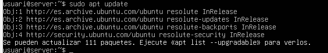
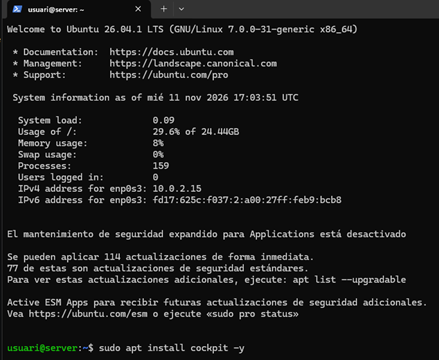
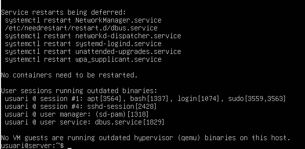
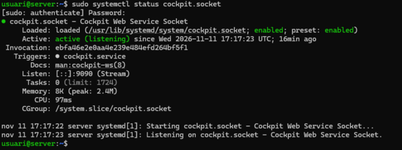
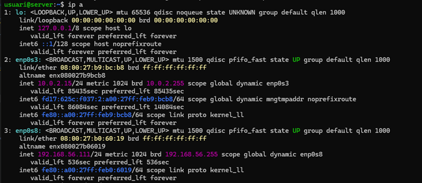

# Fase 1: individual
La eina que s'usarà per aques treball es el **Cockpit**

# Fase 2 Documentació de la instal·lació

1. Instal·lo el **Cockpit** executant:
```
sudo apt update
sudo apt install cockpit
sudo apt upgrade
```
Resultat: <br>


Em surten menys coses perquè es la segona vegada que he fet update, degut a que abans havia d'instalar i habilitar el ssh

- Ara  instal·lo el **Cockpit** <br>
 <br>
M'ha demanat la contrasenya i he agregat el **-y** perquè no salti la pregunta de confirtmació.

- Després he executat: sudo apt upgrade a dins de Ubuntu directament <br>


- Comprova si està activa <br>
```
sudo systemctl status cockpit.socket
```


2. Comprovo quina IP tinc executant:
```
ip a
```



L'adaptador amfitrió està en la nterfície enp0s8 i la seva IP és la **192.168.56.111** <br>
3. He entrat a Cockpit desde del ordinador real posant l'enllaç https://[la meva IP del **l'adaptador només amfitrió**]:[Port per defecte]
```
https://192.168.56.111:9090
```
